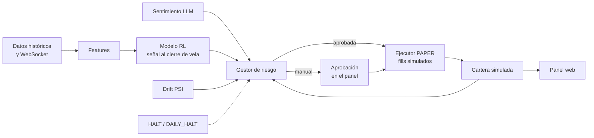

<div align="center">

# 🤖 Closed-Loop Trading Agent (Binance)

**Agente de trading de lazo cerrado: datos reales → modelo RL → gestor de riesgo → ejecución simulada (PAPER)**
Sentimiento con LLM · Detección de drift · Panel web de control · Aprobación manual de operaciones


</div>

> ⚠️ **Este proyecto NO envía órdenes reales.** `main.py` solo admite `--paper`: los fills se
> simulan localmente y no existe un gateway de órdenes conectado al gestor de riesgo. No operes
> dinero real suponiendo que los stops o el freno diario liquidarán posiciones en Binance.

---

## 📌 Índice

- [Estado del proyecto](#-estado-del-proyecto)
- [Cómo funciona](#-cómo-funciona)
- [Instalación](#-instalación)
- [Comandos](#-comandos)
- [Entrenamiento del modelo](#-entrenamiento-del-modelo)
- [Modo PAPER y aprobación manual](#-modo-paper-y-aprobación-manual)
- [Panel web](#-panel-web-opcional)
- [User Data Stream y conciliación](#-user-data-stream-y-conciliación)
- [Seguridad y gestión de riesgo](#-seguridad-y-gestión-de-riesgo)
- [Notas](#-notas)

---

## 🧭 Estado del proyecto

| Fase | Contenido | Estado |
|---|---|---|
| 1–4 | Datos, features, entrenamiento RL, riesgo, sentimiento | ✅ Implementadas |
| 5 | Orquestador en **modo paper** con simulación local de fills y panel web | ✅ Disponible |
| — | Ejecución de órdenes reales | ❌ No implementada (a propósito) |

## 🔄 Cómo funciona



El modelo calcula la señal **al cierre de cada vela**, el gestor de riesgo la filtra y solo
entonces el ejecutor PAPER simula el fill. El resultado actualiza la cartera y vuelve a
alimentar al gestor de riesgo (lazo cerrado).

## ⚙️ Instalación

```bash
python -m venv .venv && source .venv/bin/activate      # Windows: .venv\Scripts\activate
pip install -r requirements.txt                        # instala solo el langchain-* de tu proveedor LLM
cp .env.example .env                                   # rellena keys del Testnet y del LLM
```

## 🧰 Comandos

| Comando | Qué hace |
|---|---|
| `pytest -v` | 16 tests, sin red ni LLM real |
| `python scripts/check_connection.py` | Precio (+ balance si hay keys) en el entorno de `.env` |
| `python -m scripts.download_data` | Histórico → `data/raw` y features → `data/processed` |
| `python scripts/run_stream.py` | Order book y velas en vivo (Ctrl+C para salir) |
| `python scripts/run_sentiment.py` | Una pasada de sentimiento por activo (`--loop` para continuo) |
| `python scripts/run_user_stream.py` | Fills privados y cartera conciliada (solo lectura) |
| `python scripts/dashboard.py` | Solo el panel, aunque aún no haya modelo entrenado |
| `python main.py --paper --dashboard --symbols BTC/USDT` | Loop completo en PAPER (requiere modelo entrenado) |

## 🧠 Entrenamiento del modelo

```bash
python -m scripts.download_data
python -m scripts.train_rl --symbol BTC/USDT
python main.py --paper --dashboard --symbols BTC/USDT
```

**Más historia (hasta cinco años disponibles en el exchange):**

```bash
python -m scripts.download_data --refresh --history-days 1825
python -m scripts.train_rl --symbol BTC/USDT
```

**Integridad de los datos**
- La descarga conserva y fusiona el histórico existente, elimina timestamps duplicados y descarta la vela abierta.
- El entrenamiento rechaza series desordenadas, duplicadas, incompletas o con valores OHLCV/features no finitos.
- El reporte del modelo registra el intervalo y tamaño de cada split temporal.
- Se guarda una referencia normalizada **solo desde train** para calcular PSI (drift) en vivo.

**Notas de entrenamiento**
- Usa `RL_TOTAL_TIMESTEPS` (300 000 por defecto) y puede tardar.
- `main.py` necesita un modelo entrenado por símbolo en `data/models/` y acceso de red a los endpoints públicos (histórico y WebSocket).
- Para añadir ETH: descarga sus datos y entrena su propio modelo.
- El modelo `SYNTH/USDT` creado con `--synthetic` sirve **solo para probar el pipeline**; no sustituye a un modelo entrenado con histórico real.

## ✋ Modo PAPER y aprobación manual

Para revisar y autorizar cada cambio de posición desde el panel:

```bash
python main.py --paper --dashboard --manual-approval --symbols BTC/USDT
```

- No se simula ninguna orden hasta pulsar **Aprobar operación PAPER**.
- El panel muestra lado, cantidad y notional estimados, exposición actual/objetivo, motivos de riesgo y hora de caducidad.
- Las propuestas **caducan a los 2 minutos** o al procesarse una vela nueva.
- Antes de ejecutar se **reevalúa el riesgo**; si cambia el objetivo aprobado, la propuesta se cancela.
- Rechazarla no modifica la cartera.
- Este control es exclusivamente PAPER y no habilita órdenes reales.
- **Spot:** las señales negativas se interpretan como exposición cero (igual que en el entorno de entrenamiento); no se convierten en cortos.

## 📊 Panel web (opcional)

Permite observar estado, operaciones, riesgo, drift, sentimiento y logs del bot, y escribir el
archivo de control `HALT`. El servidor está en `src/dashboard` y escucha por defecto en
`127.0.0.1:8765`.

| Variable | Uso |
|---|---|
| `DASHBOARD_HOST` | Host de enlace (por defecto `127.0.0.1`) |
| `DASHBOARD_PORT` | Puerto (por defecto `8765`) |
| `DASHBOARD_TOKEN` | **Obligatorio y fuerte** si se enlaza fuera de loopback |

- Puede iniciarse por separado antes de tener modelos.
- Con `main.py --paper --dashboard`, el orquestador escribe el estado y vigila `data/live/HALT`: al activarlo, las posiciones simuladas se aplanan y el loop se detiene. **Afecta solo a la simulación local, no a Binance.**
- Las tarjetas de drift y sentimiento muestran su estado (deshabilitado, esperando datos, calentamiento o resultado) en lugar de `null`; el estado de sentimiento se persiste en `status.json`.
- **Drift CRITICAL** bloquea aperturas y aumentos de exposición, pero permite reducir o cerrar.

> 🔒 No expongas el panel públicamente sin autenticación y controles de red adecuados.

## 📡 User Data Stream y conciliación

`run_user_stream.py` escucha el User Data Stream autenticado de Binance:

| Mercado | Mecanismo | Evento |
|---|---|---|
| Spot | WebSocket API (`userDataStream.subscribe.signature`) | `executionReport` |
| USDⓈ-M Futures | User Data Stream | `ORDER_TRADE_UPDATE` |

**Qué registra**
- Cambios de estado y rechazos → `data/execution/orders_<mercado>.jsonl`
- Cada fill parcial con precio y comisión exactos → `data/execution/fills_<mercado>.jsonl`
- Concilia periódicamente `PortfolioState` desde balance/posiciones y precios (CCXT).
- `RiskManager` exige por defecto snapshots con `source=exchange`; `require_exchange_state=False` es solo para simulaciones y pruebas.

**Spot Testnet:** usa `wss://ws-api.testnet.binance.vision/ws-api/v3` (no necesita el endpoint REST antiguo de `listenKey`).

**Conciliación estricta:** si la cuenta contiene un activo sin mercado contra la divisa quote (p. ej. un token de prueba no negociable), se rechaza todo el snapshot; no se estima ese saldo a cero ni se crea un equity parcial. Usa una cuenta Testnet con solo activos valorables o espera al reset. **No desactives esta validación para operar.**

**Importante**
- El proceso **no envía ni cancela órdenes**.
- Requiere credenciales del entorno seleccionado con permiso de lectura y **sin retiros**; configura permisos y lista blanca de IP manualmente en Binance.
- Los archivos locales contienen información financiera privada y están excluidos por `.gitignore`.

## 🛡️ Seguridad y gestión de riesgo

### Topes fijos en código (independientes de la configuración)

| Control | Límite |
|---|---|
| Pérdida diaria máxima | **3 %** |
| Apalancamiento total máximo | **1×** |
| Cambio máximo de exposición por orden | **25 %** del equity |
| Stop-loss | Hasta **2 ATR** |

Los cierres forzados (stop o freno diario) y las correcciones para respetar el apalancamiento
máximo pueden superar el tamaño normal por orden, para poder liquidar o volver a un nivel permitido.

### Freno diario
- Al superar la pérdida diaria, el gestor persiste `DAILY_HALT`, emite `FLATTEN` y bloquea nuevas entradas hasta el siguiente día UTC.
- Si el estado persistido del freno está dañado, inicia bloqueado (`DRAWDOWN_HALT`).

### Entorno y credenciales
- `BINANCE_ENV=testnet` por defecto. `live` exige además `CONFIRM_LIVE_TRADING=YES`.
- El histórico de entrenamiento se baja de endpoints públicos de producción (`HISTORICAL_FROM_LIVE=true`); el Testnet se usa solo para ejecución.
- **No subas `.env` al repositorio.**
- En Binance: desactiva retiros, habilita solo los permisos necesarios y restringe las keys a IP fijas.
- Usa keys separadas para Testnet y producción.
- El software **no puede aplicar ni verificar** esos permisos ni la lista blanca de IP: configúralos directamente en Binance y no compartas las keys.

### Limitaciones conocidas
- El ejecutor `--paper` solo simula fills localmente.
- `FLATTEN` **no cancela órdenes ni cierra posiciones en Binance**.

## 📝 Notas

- **Futures:** cableado pero sin validar (el testnet de futuros de Binance cambió; revisa `enable_demo_trading` en tu versión de ccxt).
- **Sentimiento:** no generes scores LLM retroactivos para entrenar el RL (sesgo de anticipación). El histórico limpio se acumula en `data/sentiment/*.jsonl`.

---

<div align="center">

**Closed-Loop Trading Agent** · Simulación primero, riesgo siempre · Sin órdenes reales

</div>
